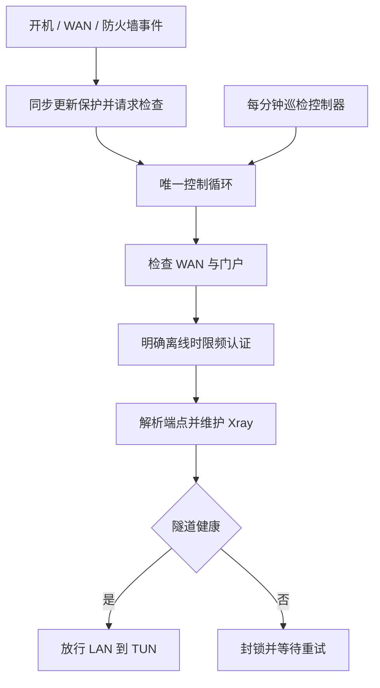

# Merlin Srun Tunnel

在 Asuswrt-Merlin 路由器上完成深澜校园网认证，并通过 Xray TUN 转发 LAN 的 IPv4、IPv6 和 DNS。隧道故障时阻断 LAN 的普通 WAN 转发，恢复后自动放行。

主要用于校园网与家庭网络之间的远程组网：由路由器统一处理校园认证和隧道连接，让 LAN 中的设备访问家庭内网的 NAS、自托管服务等资源，并使用家庭侧的 DNS 与互联网出口。家庭侧需要预先配置可达的 Xray 服务端、到内网资源的路由和访问规则。

运行逻辑只有一个 Shell 控制器和一个 AWK 编码器。配置集中在一个文件中，固件 hook 调用同一入口；日志和运行状态写入 `/tmp`，避免反复写入 JFFS。

## 适用环境

实测设备为 **RT-AC68U / Asuswrt-Merlin 386.14.2 / Linux 2.6.36.4**，使用单 LAN、单 WAN，以及支持 SRBX1 的深澜门户。代理服务端需支持 **VLESS + TLS + XHTTP stream-one**，家庭 DNS 通过隧道可达。

需要固件提供 JFFS 自定义脚本、`curl`、`openssl`、`flock`、带位运算的 `awk`、`iptables-restore`、`ip6tables-restore` 和 TUN。DNS 备用探测还使用 BusyBox 的 `nc`、`timeout -t`、`mknod`、`dd` 和 `hexdump`。其他 CPU、固件、门户、访客桥或多 WAN 拓扑需要单独适配和验证。

**Xray 是独立依赖，仓库不分发可执行文件。** RT-AC68U 的实测环境需要 `GOARM=5` 软浮点构建；架构、内核与功能兼容要求见 [Xray 构建说明](docs/XRAY.md)。

## 工作方式



| 模式 | 认证 | LAN 转发 |
| --- | --- | --- |
| `tunnel` | 自动认证 | 仅经隧道；异常时阻断 |
| `auth` | 自动认证 | 恢复固件普通转发和 DNS |
| `off` | 不发起认证 | 恢复固件普通转发和 DNS |

模式在重启后保留。`off` 不会注销已经建立的校园会话；需要注销时再执行 `logout`。端点 DNS、门户 HTTP 等必要引导流量会直连，具体边界见 [运行与配置](docs/OPERATIONS.md#流量保护与-dns)。

隧道健康默认探测家庭端点的 nginx fallback 页面，经过本地 SOCKS 完成 HTTPS 请求并检查预期状态码；主探测失败后，依次通过同一 SOCKS 向 `119.29.29.29`、`223.5.5.5` 的 TCP/53 查询 `example.com`，任一个有效 DNS 应答即可确认可用。默认不依赖 Google 或 Cloudflare。已经正常工作的隧道允许一次网络探测失败，连续两轮失败才封锁重启；冷启动、本地进程或 TUN 缺失不享受该容错，始终不回落到 WAN 直连。该检查不能代表所有公网网站、家庭 DNS 或反向组网都正常。

## 安装

以下命令在已经克隆的项目根目录执行。先在路由器启用 SSH 和 JFFS 自定义脚本，并准备与设备匹配的 Xray。

### 1. 准备配置与二进制

```sh
install -d -m 700 "$HOME/.config/merlin-srun-tunnel"
cp net-stack.conf.example "$HOME/.config/merlin-srun-tunnel/net-stack.conf"
chmod 600 "$HOME/.config/merlin-srun-tunnel/net-stack.conf"

# 将自行构建或核验过的二进制放到这里；bin/xray 已被 Git 忽略。
install -m 755 /path/to/xray bin/xray
```

编辑配置，填写门户地址和 `AC_ID`、账号密码、端点域名、UUID、TLS 名称、XHTTP 参数与家庭 DNS；同时核对接口、LAN 网段及 IPv6 ULA。确认 fallback 页面的 HTTPS 证书有效，`HEALTH_STATUS` 与其实际响应一致（默认 200）；若家庭服务器不能访问自身公网域名，换成经隧道可达的 HTTPS 目标。模板中的地址和标识仅为示例，不能直接用于登录。配置采用 Shell 语法，只加载自己信任的文件。字段说明见 [配置参考](docs/OPERATIONS.md#配置参考)。

### 2. 上传并安装

```sh
ROUTER=admin@192.168.50.1    # 改为目标路由器
CONFIG="$HOME/.config/merlin-srun-tunnel/net-stack.conf"

ssh "$ROUTER" 'umask 077; mkdir -p /tmp/net-stack-install/bin /tmp/net-stack-install/docs'
scp -O netctl.sh xencode.awk install.sh README.md LICENSE "$ROUTER:/tmp/net-stack-install/"
scp -O docs/*.md "$ROUTER:/tmp/net-stack-install/docs/"
scp -O "$CONFIG" "$ROUTER:/tmp/net-stack-install/net-stack.conf"
scp -O bin/xray "$ROUTER:/tmp/net-stack-install/bin/"
ssh "$ROUTER" 'sh /tmp/net-stack-install/install.sh'
ssh "$ROUTER" 'reboot'
```

`scp -O` 使用老版 Dropbear 支持的 SCP 协议。通过 SSH 密钥或交互提示认证；真实配置保存在仓库外。

安装器先验证配置和编码向量，再备份已有程序及 hook，部署到 `/jffs/scripts/net-stack`。它会禁用 CTF，**必须重启才能彻底停止硬件加速绕过软件规则**。支持全新安装与同路径升级；更早的独立认证或代理脚本需先停止，避免两套入口同时运行。

### 3. 确认运行状态

重连路由器后执行：

```sh
/jffs/scripts/net-stack/netctl.sh status
/jffs/scripts/net-stack/netctl.sh auth-status
```

正常状态为 `mode=tunnel state=tunnel-online gate=allow`，并显示控制器和 Xray 的 PID。初始化、校时和认证需要时间；完整诊断方法见 [验收与诊断](docs/OPERATIONS.md#验收与诊断)。

## 日常操作

以下命令在路由器执行：

```sh
CTL=/jffs/scripts/net-stack/netctl.sh
$CTL uptime          # 并排显示系统、校园认证会话和 Xray 运行时长
$CTL mode auth       # 保留自动认证，恢复普通直连
$CTL mode tunnel     # 恢复隧道保护
$CTL login           # 请求检查；仍遵守登录限频
$CTL check           # 验证配置和编码向量
$CTL health          # 立即探测并返回 health_status，不改防火墙或重启服务
$CTL restart         # 修改配置后重载
$CTL password        # 交互更新校园密码
```

升级时重新运行安装器。每次安装都会打印独立的 `rollback.sh` 路径；它能恢复该次安装前的程序、配置和 hook。备份含真实凭据，请在确认不再需要回滚后再清理。模式切换和 `restart` 会异步恢复网络，以 `status` 为准。

## 仓库结构与开发

```text
netctl.sh                 控制器、命令入口、固件 hook
xencode.awk               SRBX1 编码
net-stack.conf.example    无凭据的配置模板
install.sh                安装、升级与生成回滚脚本
bin/README.md             Xray 放置说明；二进制不入库
docs/OPERATIONS.md        配置、架构、诊断和兼容性处理
docs/TESTING.md           测试方法、实机记录与边界
docs/XRAY.md              二进制来源、构建与上游许可
tests/                    隔离回归与显式实机测试
```

Linux 开发机上运行，无需路由器、真实配置或 Xray。除 Python 3.10+ 外，协议回归测试需要 `nc`、`timeout`、`mknod`、`dd` 和 `hexdump`；Debian/Ubuntu 可安装 `netcat-openbsd`、`bsdextrautils` 和 `coreutils`：

```sh
sh -n netctl.sh && sh -n install.sh
python3 -m unittest discover -s tests -v
python3 tests/live.py --help
```

GitHub Actions 执行语法检查和隔离回归。实机测试需要主动运行，部分场景会重启设备或中断网络，见 [测试说明](docs/TESTING.md)。提交问题时附固件版本、模式、复现步骤和脱敏日志；账号、密码、UUID、端点域名、配置和原始备份不应附在公开 Issue 中。

## 许可

本仓库项目代码和文档采用 [MIT License](LICENSE)。Xray 是独立的第三方项目，其许可证和依赖声明见 [Xray 构建说明](docs/XRAY.md#上游许可)。
